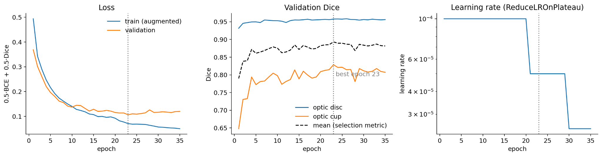
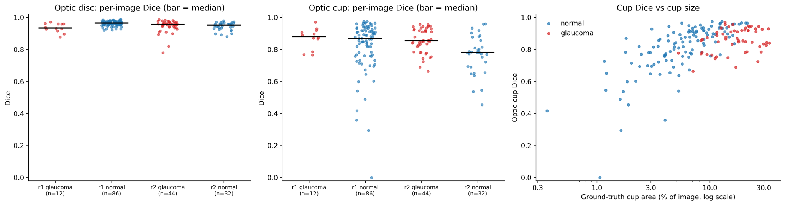
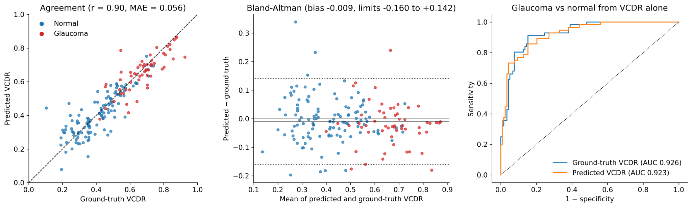

# Optic Disc and Optic Cup Segmentation for Glaucoma Analysis

A PyTorch computer-vision project for **joint segmentation of the optic disc (OD) and optic cup (OC)** in retinal fundus photographs. The segmentation masks are also used to estimate the vertical cup-to-disc ratio (VCDR) and examine its agreement with reference measurements.

> **Research prototype only.** This repository is not a medical device and must not be used for diagnosis, screening, or treatment decisions.

## Project at a glance

- **Dataset:** RIM-ONE DL (485 fundus images with expert optic-disc and optic-cup masks).
- **Task:** two-channel semantic segmentation (optic disc + optic cup).
- **Model:** U-Net with a ResNet34 encoder initialized with ImageNet weights.
- **Input:** RGB fundus images resized to 512 × 512.
- **Loss:** 0.5 × binary cross-entropy with logits + 0.5 × per-image soft Dice loss.
- **Training split:** the dataset's provided hospital partition; validation is stratified from the original training partition.
- **Post-processing:** threshold at 0.5 and enforce cup-inside-disc containment.
- **Additional analysis:** VCDR estimation, correlation, Bland–Altman agreement, and descriptive ROC-AUC analysis.

## Selected results from the completed experiment

The following values are taken from the completed run included with this project. Test metrics were calculated at **original image resolution** on 174 test images (56 glaucoma and 118 normal; 98 images from source `r1` and 76 from `r2`). The final split contained 264 training images, 47 validation images, and 174 test images.

| Metric | Optic disc | Optic cup |
|---|---:|---:|
| Mean Dice | **0.9533** | **0.8231** |
| Median Dice | 0.9595 | 0.8545 |
| Mean IoU | 0.9120 | 0.7184 |

Additional VCDR analysis on the same test set:

| Measure | Result |
|---|---:|
| Pearson correlation: predicted vs. ground-truth VCDR | 0.903 |
| Mean absolute VCDR error | 0.056 |
| Mean VCDR bias (predicted − ground truth) | −0.009 |
| Bland–Altman 95% limits of agreement | −0.160 to +0.142 |
| ROC-AUC using predicted VCDR alone to separate dataset labels | 0.923 |

The VCDR-derived ROC-AUC is **descriptive dataset analysis**, not evidence of clinical diagnostic performance. Results are from one dataset and one fixed test partition; independent external validation is still required.

### Training history

The model was trained for 35 epochs with early stopping. The best validation checkpoint was selected at epoch 23, with a mean validation Dice of 0.8932 (optic disc 0.9578; optic cup 0.8286).



### Test-set segmentation performance



### VCDR agreement analysis



## Repository structure

```text
.
├── assets/
│   ├── training_curves.png
│   ├── test_dice_by_group.png
│   └── vcdr_agreement.png
├── configs/
│   └── default.json
├── scripts/
│   ├── prepare_data.py
│   ├── train.py
│   ├── evaluate.py
│   ├── analyze_vcdr.py
│   └── predict.py
├── src/
│   └── glaucoma_seg/
│       ├── data.py
│       ├── dataset.py
│       ├── transforms.py
│       ├── model.py
│       ├── losses.py
│       ├── metrics.py
│       ├── train_engine.py
│       ├── evaluate.py
│       └── vcdr.py
├── tests/
│   └── test_vcdr.py
├── .gitattributes
├── .gitignore
├── LICENSE
├── README.md
└── requirements.txt
```

## Dataset

This project uses **RIM-ONE DL**. Download the dataset from the [official RIM-ONE DL repository](https://github.com/miag-ull/rim-one-dl) and read its terms before use. The dataset is provided for research and educational use; the dataset maintainers state that copying/redistribution and unauthorized commercial use are not permitted. **Do not upload the original fundus images or reference masks to this GitHub repository.** The dataset has its own terms and is not covered by this repository's code license.

The expected extracted folders are:

```text
data/
└── raw/
    ├── RIM_ONE_DL_images/
    │   ├── partitioned_by_hospital/
    │   │   ├── training_set/
    │   │   │   ├── glaucoma/
    │   │   │   └── normal/
    │   │   └── test_set/
    │   │       ├── glaucoma/
    │   │       └── normal/
    │   └── partitioned_randomly/
    │       ├── training_set/
    │       └── test_set/
    └── RIM_ONE_DL_reference_segmentations/
        ├── glaucoma/
        └── normal/
```

The mask filenames must follow the RIM-ONE DL convention, for example `image_stem-1-Disc-T.png` and `image_stem-1-Cup-T.png`. If your extracted archive has an extra wrapper directory, point `--images-root` and `--masks-root` to the directories that contain the folders shown above.

### Dataset citation

Fumero Batista, F. J., Díaz-Alemán, T., Sigut, J., Alayón, S., Arnay, R., & Angel-Pereira, D. (2020). *RIM-ONE DL: A Unified Retinal Image Database for Assessing Glaucoma Using Deep Learning*. Image Analysis & Stereology, 39(3), 161–167. https://doi.org/10.5566/ias.2346

## Setup

Python 3.10–3.12 is recommended. A CUDA-capable NVIDIA GPU is recommended for training; CPU inference and evaluation are also supported.

1. Clone the repository and enter it:

   ```bash
   git clone https://github.com/<your-username>/<your-repository>.git
   cd <your-repository>
   ```

2. Create and activate an environment:

   ```bash
   python -m venv .venv
   # Windows PowerShell
   .venv\Scripts\Activate.ps1
   # macOS/Linux
   source .venv/bin/activate
   ```

3. Install PyTorch for your machine. For GPU support, use the command generated by the [official PyTorch installation selector](https://pytorch.org/get-started/locally/) so that the CUDA wheel matches your driver and platform. The completed experiment recorded PyTorch `2.11.0+cu128`.

4. Install the remaining dependencies:

   ```bash
   pip install -r requirements.txt
   ```

## Prepare the data

After downloading and extracting RIM-ONE DL into the structure above, run:

```bash
python scripts/prepare_data.py \
  --images-root data/raw/RIM_ONE_DL_images \
  --masks-root data/raw/RIM_ONE_DL_reference_segmentations \
  --output-dir data/processed
```

This checks the image/mask pairs, validates their dimensions and class labels, creates a manifest, and writes both official partition variants:

- `data/processed/splits_hospital.csv`
- `data/processed/splits_random.csv`

The default experiment uses `hospital`, as specified in `configs/default.json`. The validation set is sampled only from the supplied training subset (15%, stratified by class and source); the supplied test subset is left unchanged. The generated CSVs are local working files and are intentionally excluded from Git.

## Train

```bash
python scripts/train.py --config configs/default.json
```

The script saves:

- `outputs/checkpoints/best.pt` — best validation checkpoint.
- `outputs/checkpoints/latest.pt` — resumable training checkpoint.
- `outputs/metrics/history.json` — epoch-wise training and validation metrics.

Training resumes from `latest.pt` when present. To start a fresh run:

```bash
python scripts/train.py --config configs/default.json --no-resume
```

The default configuration mirrors the completed experiment: seed 42, 512 × 512 images, batch size 4, AdamW, learning rate 1e-4, weight decay 1e-2, ReduceLROnPlateau, and early stopping.

## Evaluate

```bash
python scripts/evaluate.py \
  --config configs/default.json \
  --checkpoint outputs/checkpoints/best.pt
```

Evaluation uses the untouched test subset and the original image resolution by default. Per-image metrics and summaries are saved to `outputs/metrics/` as CSV files. These are generated outputs, not source files, and remain git-ignored.

## VCDR analysis

To reproduce the VCDR agreement and exploratory ROC analysis from the test set:

```bash
python scripts/analyze_vcdr.py \
  --config configs/default.json \
  --checkpoint outputs/checkpoints/best.pt
```

This calculates ground-truth and predicted VCDR at original image resolution, reports Pearson/Spearman correlation, MAE, bias, Bland–Altman limits, and bootstrap confidence intervals for the VCDR-only ROC-AUC. It saves `outputs/metrics/test_vcdr.csv` and `outputs/graphs/vcdr_agreement.png`. The ROC-AUC is descriptive only and is not a clinical diagnostic metric.

## Predict on one image

```bash
python scripts/predict.py path/to/fundus_image.png \
  --checkpoint outputs/checkpoints/best.pt
```

The script writes two binary PNG masks to `outputs/predictions/`:

- `<image>_disc.png`
- `<image>_cup.png`

The predicted cup mask is intersected with the predicted disc mask to enforce anatomical containment.

## Model and implementation notes

- The model has two output channels: channel 0 is the optic disc and channel 1 is the optic cup.
- The network returns logits; sigmoid and thresholding are applied during evaluation/inference.
- Image resizing uses bilinear interpolation; mask resizing uses nearest-neighbour interpolation.
- Training augmentation is applied jointly to the image and both masks. Geometric transforms are shared, and vertical flipping is intentionally not used.
- Loss is averaged per image and per structure to reduce domination by images with larger structures.
- The primary test evaluation upsamples logits to each image's native dimensions before comparison with original masks.
- Cup containment is enforced at inference/evaluation by `cup = cup AND disc`.
- VCDR is calculated as the ratio of the vertical bounding-box extent of the cup to that of the disc.

## Tests

Run the utility tests with:

```bash
pytest -q
```

## What is intentionally not included

To keep the repository lightweight and avoid redistributing data or machine-specific experiment artifacts, this repository does **not** include:

- RIM-ONE DL fundus images or expert segmentation masks;
- generated CSV manifests, split tables, or per-image result exports;
- model checkpoints (`.pt` / `.pth` files);
- Kaggle working directories, caches, or temporary archives;
- image grids containing source fundus photographs.

Only code, configuration, documentation, and the result plots needed to understand the experiment are included.

## Limitations

- The test set contains 174 images from the provided hospital partition; this is not a substitute for validation on independent datasets, devices, or clinical populations.
- Optic-cup segmentation is more difficult than optic-disc segmentation, as reflected by its lower Dice score.
- VCDR can be sensitive to cup boundary errors and poor-quality images.
- The ROC-AUC analysis uses VCDR alone and the dataset's existing labels; it is exploratory and not a validated diagnostic classifier.
- No clinical claims or patient-level conclusions should be drawn from these results.

## License

The source code in this repository is released under the MIT License. The RIM-ONE DL data remains subject to its separate dataset terms. See the [official dataset repository](https://github.com/miag-ull/rim-one-dl) before downloading or using it.
